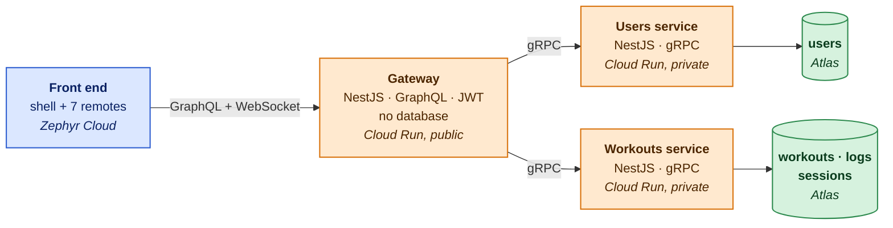
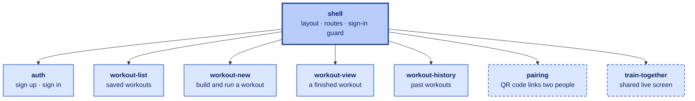
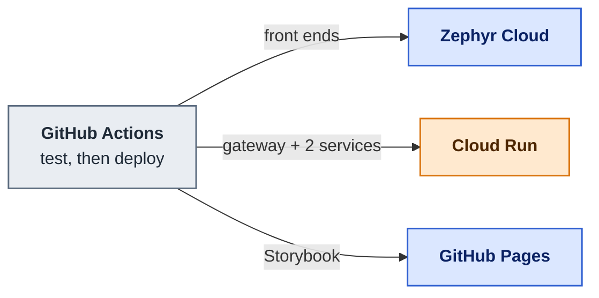

# Workout Tracker: 3-Day Build Plan

A portfolio rebuild of the 2021 WorkoutTracker SPA: an Nx monorepo with Module Federation front ends on Zephyr, a NestJS GraphQL gateway, two NestJS gRPC services, and MongoDB.

**Auth:** email + password. The users service stores and checks passwords; the gateway issues a JWT. No roles: every query is scoped to its owner.

**Language:** English only, no i18n.

## Architecture

### The system

The browser talks only to the gateway, which keeps no data of its own. It calls the users and workouts services over gRPC, and each service owns its own database on one Atlas cluster.



### The front end

The shell is the only app the browser loads directly; it pulls in each remote at runtime. Remotes never load each other: `workout-new` and `workout-view` both render the workout screen from the `ui` library (`workout-view` in read-only mode), so the exercise and set components exist in one place. Dashed borders mark the train-together bonus.



### Delivery

One pipeline tests every change, then ships each part to where it runs.



## Workspace

> [!NOTE] Boundary rules
>
> - Two top-level folders, `client/` and `server/`. They never import each other, and nothing is shared between them.
> - A library lives on the side that imports it. A value both sides need, such as an input limit, goes in that side's own `limits` library; the server's copy is the one enforced.
> - Every project is tagged `scope:client` or `scope:server` (matching its folder) and `type:app` or `type:lib`. `@nx/enforce-module-boundaries` turns the rules into lint errors.

### Projects

Each line reads: folder (kind): what it holds. Projects with end-to-end tests say so.

- `client/`: React front end
  - `shell/` (host): layout, routes and the sign-in guard; loads every remote. _Unit and e2e tests._
  - `auth/` (remote): sign-up and sign-in screens
  - `workout-list/` (remote, port 8104): saved workouts, with add and delete
  - `workout-new/` (remote, port 8103): build, run, finish and save a workout as a template; renders `ui`'s `Workout`
  - `workout-view/` (remote, port 8101): a finished workout, read-only; renders `ui`'s `Workout` with `mode="view"`
  - `workout-history/` (remote, port 8102): completed workouts, with delete
  - `pairing/` (remote): shows your QR code and scans a partner's to link two trainings
  - `train-together/` (remote): the shared training screen, with each exercise as it's completed
  - `ui/` (lib): generic components, documented in Storybook: Button, Card, Badge, Dialog, Container, TextInput, TextLabel, SectionHeading, EmptyMessage, AddItemForm, plus the `tone` and `motion` helpers. Also the workout screen shared by `workout-new` and `workout-view`: `Workout` (the only part exported), its exercise and set components, and `buildLog`. _Unit tests._
    - `src/theme.css`: the Tailwind theme every remote imports
  - `hooks/` (lib): `useTimer`, `useNotification`, and `usePersistence` (IndexedDB, deprecated until `workout-repository` replaces it)
  - `auth-state/` (lib): token storage, `AuthProvider`, `useAuth`; loaded once and shared by every remote
  - `api/` (lib): Apollo Client, the auth link and generated GraphQL hooks
  - `workout-repository/` (lib): `WorkoutRepository`, with IndexedDB and GraphQL adapters
  - `types/` (lib): `Workout`, `Exercise`, `Set`, `WorkoutLog`
  - `reducer/` (lib): the workout state machine: actions (including `UPDATE_SET` and `UPDATE_EXERCISE_RPE`) and set stages
  - `utils/` (lib): `timeFormat`, date formatting (`Intl`), `linkClickHandler`, `genId`, completeness checks and the IndexedDB `Database`
  - `limits/` (lib, project `client-limits`): form hints for sets, reps and weights
- `server/`: NestJS back end
  - `gateway/` (app): GraphQL, JWT, guards and DataLoaders; no database. _Unit and e2e tests._
    - `src/`: one folder per feature: `auth/`, `users/`, `workouts/`, `sessions/`, `graphql/`
  - `users-svc/` (app): the `users` collection and argon2 hashing; gRPC `CreateUser`, `VerifyCredentials`, `GetUsers`. _Unit and e2e tests._
  - `workouts-svc/` (app): workouts, logs and train-together sessions, with change streams. _Unit and e2e tests._
  - `proto/` (lib): the `.proto` files (`workouts`, `sessions`, `users`), buf config, generated code and loader options
  - `limits/` (lib, project `server-limits`): the input limits the server enforces
- `tools/`: Docker and deploy scripts
- `nx.json`, `package.json`, `tsconfig.base.json`

### Inside a project

- `<project>/`
  - `src/`: the code. A library exports only `src/index.ts`. Unit specs (`*.spec.ts`) and stories (`*.stories.tsx`) sit next to the file they cover.
  - `tests/`: planned for the server, `*.spec.ts` files mirroring `src/`, with `unit/` and `e2e/` when a project has both kinds
  - `.storybook/`: in `ui` and in every client remote

### Conventions

- File names in kebab-case.
- Nest code: one feature module per folder, such as `users/users.module.ts`, `users.service.ts`, `users.resolver.ts`.
- Remotes: components in `src/components/`, each with a story; the federated entry is `src/App.tsx`. A component belongs to the view that uses it. One used by several views goes to `ui`, including the workout screen that `workout-new` and `workout-view` share. Remotes never load each other's code at runtime.
- Views take an optional `navigate` prop from the shell, so their links move within the SPA instead of reloading.
- Strings are plain English; there is no translation layer.
- Styling: each remote imports its own `src/styles.css` (Tailwind 4 through PostCSS, with `@source` for `ui` and for any remote whose components it renders). Storybook uses the Vite plugin instead.
- Libraries are imported through `@workout-tracker/<name>`. Nx project names must be unique, so the two `limits` folders are the projects `client-limits` and `server-limits`. Remotes are never imported: only the shell loads them, through Module Federation.
- Generators run with `--e2eTestRunner=none`. Each project's test config points at `tests/`, and projects with e2e tests get a separate `e2e` target with its config in `tests/e2e/`.

## Running locally

```sh
npx nx serve shell              # the shell on :8100; serve each remote the same way
npx nx serve workout-view       # also starts the shell
npx nx storybook workout-new    # or ui, workout-view, workout-history, workout-list
npx nx run-many -t lint test
```

Storybook picks port 6006 and offers another if it is taken; pass `-- --port <n>` to run several at once. `npx nx build-storybook <project>` writes `storybook-static/`, which is gitignored but should be deleted before linting.

## Day 1: The Front End on Nx (Still IndexedDB)

- [x] **Workspace**
  - [x] Create it with `create-nx-workspace`, pinned to Node 24
  - [x] Add the plugins: `@nx/react`, `@nx/nest`, `@nx/js`, `@nx/module-federation`, `@nx/storybook`
  - [x] Add the tags and the boundary rule
- [x] **`client/types`**, **`client/reducer`**, **`client/utils`**, **`client/limits`**
  - [x] Port the types, the reducer and its actions, and the time utilities, with tests in `tests/`
  - [x] Stop saving runtime fields (`stage`, `activeSetId`) in workout templates
  - [x] Remove the DOM reads by moving a set's reps, weight, rest and time into reducer state; the views build the log with `buildLog`. `serializeWorkout` is still in `utils`, now unused
- [x] **`client/ui`** with Storybook
  - [x] Port the components to Tailwind 4, with a story each. View-specific ones then moved into their remotes (see Conventions)
  - [x] Load `theme.css` in `.storybook/preview.css`, and add `@storybook/addon-a11y`
  - [x] Storybook in every remote too
- [x] **`client/hooks`**: `useTimer`, `useNotification`
- [x] **`client/workout-repository`**: the `WorkoutRepository` interface and its IndexedDB adapter
- [x] **Module Federation**
  - [x] `shell` host, plus the `workout-list`, `workout-new`, `workout-view` and `workout-history` remotes (Rspack)
  - [x] React 19 and React Router 7
  - [x] Share react, react-router, `@apollo/client` and `auth-state` as singletons
- [x] Fix the old issues:
  - [x] Switch to `createRoot`
  - [x] Stop passing an async function to `useEffect`
  - [x] Correct the `tabuler-nums` typo
- [ ] **Zephyr**: add `withZephyr()` to each Rspack config and deploy

**Done when:** the app runs from its Zephyr URL, still storing data in IndexedDB, and each project's Storybook shows its components.

## Day 2: Back End, Sign-In and Deploy

- [ ] **`server/proto`**
  - [ ] `workouts.proto` and `users.proto` (packages `workouts.v1` and `users.v1`)
  - [ ] `buf.yaml` and `buf.gen.yaml` with the ts-proto options `nestJs=true`, `addGrpcMetadata=true`, `stringEnums=true` and `useDate=false`
  - [ ] A cached `codegen` target, with `dependsOn: ["^codegen"]` in the projects that use it
  - [ ] One set of proto-loader options shared by every server and client
- [ ] **`server/limits`**
- [ ] **`server/users-svc`**
  - [ ] Nest gRPC microservice with its own database
  - [ ] `users` collection with a unique, lowercased email
  - [ ] `CreateUser` and `VerifyCredentials` with argon2id; one error for any failed check
  - [ ] `GetUsers`, a batch lookup by ID
  - [ ] Unit tests in `tests/unit/`, e2e tests over gRPC in `tests/e2e/`
- [ ] **`server/workouts-svc`**
  - [ ] Nest gRPC microservice with its own database
  - [ ] Mongoose schemas typed from the generated code, plus a `toProto` mapper
  - [ ] Every query filtered by `ownerId`, returning NOT_FOUND for other users' data
  - [ ] Create, read, update and delete for workouts, plus logs
  - [ ] `GetLastRuns` aggregation
  - [ ] Unit and e2e tests
- [ ] **`server/gateway`**
  - [ ] Configuration validated with zod; no database connection
  - [ ] `signUp` and `signIn` call users-svc, then issue a 7-day JWT; `me` reads it
  - [ ] Global guard, `@Public()`, `@CurrentUser()`
  - [ ] Rate limiting with `@nestjs/throttler`
  - [ ] Code-first GraphQL types, resolvers and `toGql` mappers
  - [ ] DataLoader for `lastRunAt`
  - [ ] Map gRPC errors to GraphQL errors
  - [ ] Unit and e2e tests
- [ ] **Front end**
  - [ ] `client/api`: Apollo Client, the auth link and generated hooks
  - [ ] `client/auth-state`: `AuthProvider` and `useAuth`
  - [ ] `auth` remote: sign-up and sign-in screens
  - [ ] Shell redirects signed-out users to sign-in
  - [ ] GraphQL adapter for `WorkoutRepository`
- [ ] **Local setup**: Docker Compose running MongoDB as a single-node replica set
- [ ] **Deploy**
  - [ ] MongoDB Atlas free cluster, one database per service
  - [ ] Secrets in Secret Manager
  - [ ] Dockerfiles
  - [ ] `gateway` on Cloud Run, public
  - [ ] `users-svc` and `workouts-svc` on Cloud Run with `--use-http2`, private
  - [ ] `roles/run.invoker` for the gateway, and a Google ID token on each of its gRPC calls
  - [ ] CORS restricted to the Zephyr origin

**Done when:** you can sign up on the deployed app and your workouts persist in Atlas.

## Day 3 Morning: Quality

- [ ] **Tests**
  - [ ] Gateway e2e against `MongoMemoryReplSet`: sign up, create and list workouts, and confirm a second user can't see them
  - [ ] Shell e2e with Playwright: sign up, build a workout, run it
- [ ] **CI on pull requests**: `nx affected -t lint test e2e build`, plus `buf lint`, `buf breaking` and a check that generated code is up to date
- [ ] **CI on main**
  - [ ] Deploy tier by tier (services, then gateway, then front ends), using Workload Identity Federation instead of stored keys
  - [ ] Publish Storybook to GitHub Pages
- [ ] **README**: these diagrams, how to run locally, and the tradeoffs chosen

## Day 3 Afternoon: Train Together (Bonus)

- [ ] **`sessions.proto`**: `StartSession`, `JoinSession`, `ReportProgress`, and `WatchSession` as a server stream
- [ ] **Session schema**: join code, participants, and `expiresAt` with a TTL index
- [ ] **workouts-svc**: change stream → Observable that sends the current snapshot first and closes the stream when the client disconnects
- [ ] **Gateway**
  - [ ] `sessionUpdated` subscription bridged from the gRPC stream, authenticated through graphql-ws `connectionParams`
  - [ ] Partner display names from users-svc's `GetUsers`, batched with a DataLoader
- [ ] **`pairing` remote**: show a QR code with the join link (`qrcode`), scan a partner's with the camera (`@zxing/browser`)
- [ ] **`train-together` remote**: each completed exercise for both partners, and a shared rest timer based on `resting_until`
- [ ] **Shell e2e**: two Playwright browser contexts pair and train together
- [ ] Deploy, then demo with two accounts on two devices

## Cut (Unless Time Is Left Over)

- PWA offline support
- Data import
- GitHub sign-in
- Email verification, password reset and refresh tokens
