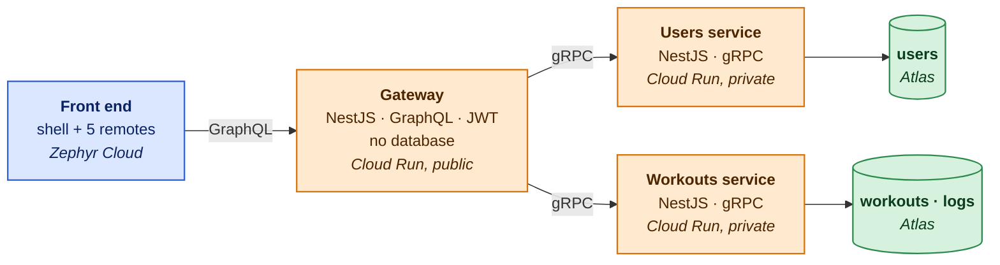
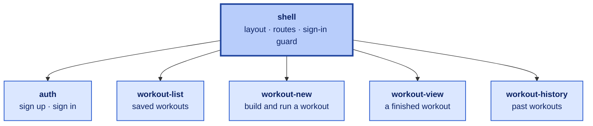
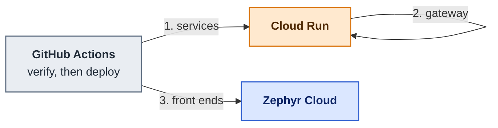

# Workout Tracker

A workout app where you build routines, run them set by set with a rest timer and RPE, and look back at what you did. It's a rebuild of a 2021 single-page app, and the point of the rebuild is the architecture: a **micro-frontend** UI talking to a **backend-for-frontend (BFF)** gateway, with small gRPC services behind it.

**Stack:** Nx monorepo · React 19 · Module Federation (Rspack) on Zephyr Cloud · NestJS GraphQL gateway · NestJS gRPC services · MongoDB Atlas · Cloud Run

## What you get

- Sign up and sign in with email and password.
- Build a workout from exercises and sets, and save it as a template.
- Run a workout live, with a rest timer and an RPE scale per exercise.
- Browse finished workouts in your history.
- Your data is yours: every query is scoped to the signed-in user.

## The big idea

The front end is split into **independent apps** (a shell and five remotes) that are stitched together in the browser at runtime. The browser talks to **one backend**, a GraphQL gateway shaped around what the screens need. The gateway holds no data. It calls two small gRPC services, and each service owns its own database.

So each layer has one job:

| Layer         | Job                                                                 |
| ------------- | ------------------------------------------------------------------- |
| Shell         | Layout, routing, the sign-in guard. Loads the remotes.              |
| Remotes       | One screen or feature each. Built and deployed on their own.        |
| Gateway (BFF) | One GraphQL endpoint for the UI. Auth, validation, error mapping.   |
| Services      | Domain logic and storage (users, workouts). Private, gRPC only.     |

## Architecture

### The system

The browser only ever sees the gateway. The services are private and only accept calls from the gateway's service account.



**Why a BFF gateway?** The UI asks for exactly the data a screen needs in one round trip, and never learns that two services exist. Passwords, JWTs, rate limits and error translation live in one place. Swapping or splitting a service later doesn't touch the front end.

**Why gRPC between the gateway and services?** A typed contract (`.proto` files, checked with `buf`) that both sides generate code from. Breaking it fails CI rather than production.

**Why a database per service?** Each service can change its schema, scale, or move to another store without asking anyone. The cost is that joins happen in the gateway, so it batches lookups with DataLoader.

### The front end

The shell is the only app the browser loads directly. It pulls in each remote at runtime through Module Federation. Remotes never load each other. When two remotes need the same screen, such as `workout-new` and `workout-view` (read-only), they render it from the shared `ui` library.



**Why micro-frontends?** Each remote has its own build, dev server, Storybook and deploy. A change to `workout-history` ships without rebuilding the rest, and in a bigger team it would belong to a different squad. React, React Router, Apollo Client and the auth state are shared singletons, so the pieces behave like one app.

### Delivery

One pipeline tests every change, then ships each part to where it runs.



Pushing a `staging-*` tag deploys staging, and a `v*` tag deploys production. The order matters: services first, then the gateway, then the front ends, so a new UI never calls an old gateway.

## Scalability

- **Stateless backends.** The gateway and both services keep nothing in memory between requests, so Cloud Run can add or remove instances freely.
- **Scale each piece alone.** If workouts get hot, scale `workouts-svc` and leave `users-svc` at its minimum. The databases are separate too.
- **Batched reads.** A DataLoader in the gateway turns "last run of each workout" from N calls into one.
- **Independent front-end deploys.** Remotes are built and published separately, so teams don't queue behind one build.
- **Fast builds as the repo grows.** Nx caches results and runs only what a change affects. Module boundary rules (`scope:client`, `scope:server`, `type:app`, `type:lib`) are lint errors, so the structure doesn't rot.

## Reliability

- **Private services.** On Cloud Run, the services accept only the gateway's service account (`roles/run.invoker`), and the gateway signs each call with a Google ID token.
- **Deadlines on every gRPC call**, so a slow service fails fast instead of hanging the request.
- **Fail at boot, not at 2 a.m.** Every server validates its environment with zod and refuses to start if anything is missing. Staging never falls back to development values.
- **Typed errors end to end.** gRPC errors are mapped to GraphQL errors in one filter. Failed sign-ins return one generic error, so the API doesn't reveal which emails exist.
- **Safe auth basics.** Passwords are hashed with argon2id, sign-in is rate limited per caller, and every query is filtered by owner. Asking for someone else's workout returns "not found".
- **Contracts checked in CI.** `verify.yml` runs format, lint, type-check, unit tests, builds, `buf lint`, and confirms the generated proto and GraphQL code match their sources.
- **Secrets stay out of the repo.** Deployed values live in Secret Manager. CI authenticates to GCP with Workload Identity Federation instead of stored keys.

## Run it locally

### What you need

| Requirement          | Version | Why                                           |
| -------------------- | ------- | --------------------------------------------- |
| Node.js              | 22+     | CI and the Docker images use 26               |
| npm                  | 10+     | Ships with Node                               |
| Docker with Compose  | recent  | Runs MongoDB as a single-node replica set     |
| Free ports           |         | 8100 to 8105 (front ends), 3000 (gateway), 27017 (MongoDB), 50051 and 50052 (gRPC) |

No cloud account is needed to run locally. Zephyr is only switched on for the `deploy` target.

### Steps

```sh
# 1. Install
npm install

# 2. Give the gateway a JWT secret (32+ characters; this file is gitignored)
echo "JWT_SECRET=$(openssl rand -hex 32)" > server/gateway/.env.development.local

# 3. Start MongoDB in Docker, then every app in the workspace
npm run dev
```

Then open **http://localhost:8100**, create an account, and build a workout.

### Handy commands

```sh
npx nx serve shell                 # just the shell on :8100
npx nx serve workout-view          # one remote (also starts the shell)
npx nx storybook ui                # component docs; also works for each remote
npx nx run-many -t lint typecheck test   # what CI runs
npx nx graph                       # see how the projects depend on each other
```

Debuggers listen on 9229 (gateway), 9230 (users-svc) and 9231 (workouts-svc). The VS Code and Zed configs in the repo already point at them.

### Environments

There are three: `development`, `staging` and `production`. The Nx configuration name picks one, and `npm run dev:staging` runs local processes against staging's database. Env files come in layers:

| File                               | Committed | Holds                                                    |
| ---------------------------------- | --------- | -------------------------------------------------------- |
| `.env.<config>` (root)             | yes       | `APP_ENV`                                                |
| `server/<app>/.env.<config>`       | yes       | per-environment values, such as the dev `MONGODB_URI`    |
| `server/<app>/.env.serve`          | yes       | local ports, gRPC addresses and `CORS_ORIGINS`           |
| `server/<app>/.env.<config>.local` | no        | secrets: `JWT_SECRET`, a hosted `MONGODB_URI`            |

## Tour of the repo

Two top-level folders, `client/` and `server/`. They never import each other. Anything both sides need, like an input limit, gets its own copy on each side, and the server's copy is the one that's enforced.

```text
client/
  shell/            host app: layout, routes, sign-in guard (:8100)
  auth/             remote: sign up and sign in (:8105)
  workout-list/     remote: saved workouts (:8104)
  workout-new/      remote: build, run and save a workout (:8103)
  workout-view/     remote: a finished workout, read-only (:8101)
  workout-history/  remote: completed workouts (:8102)
  ui/               component library with Storybook, plus the shared Workout screen
  hooks/            useTimer, useNotification, and data hooks that hide GraphQL
  api/              Apollo Client, generated GraphQL types, mountApp
  auth-state/       token storage and AuthProvider, shared by every remote
  reducer/          the workout state machine
  types/            Workout, Exercise, Set, WorkoutLog
  utils/            time and date formatting, small helpers

server/
  gateway/          GraphQL BFF: auth, guards, DataLoaders, error mapping
  users-svc/        users collection, argon2 hashing, gRPC
  workouts-svc/     workouts and logs, gRPC
  proto/            .proto contracts, buf config, generated code
  helpers/          env validation, error helpers shared by the servers

tools/
  docker/           one Dockerfile that runs any of the three servers
  nx/               a local Nx plugin that adds a typecheck target
.github/workflows/  verify.yml (every PR) and deploy.yml (tags)
```

Good places to start poking around:

- `client/shell/rspack.config.ts` and `client/shell/src/mf.ts` for how remotes are wired in.
- `client/reducer/src/lib/reducer.ts` for the workout state machine.
- `server/proto/protos/` for the contracts between the gateway and services.
- `server/gateway/src/workouts/` for a resolver, a gRPC client and a DataLoader side by side.
- `.github/workflows/deploy.yml` for the tier-by-tier deploy.

Libraries are imported as `@workout-tracker/<name>`. Remotes are never imported, only loaded by the shell at runtime.

## Deploying your own copy

You'll need a GCP project, a MongoDB Atlas cluster and a Zephyr Cloud account. One-time setup for `deploy.yml`:

- An Artifact Registry Docker repository named `workout-tracker` in `GCP_REGION`.
- Three service accounts: a deployer (Cloud Run Admin, Artifact Registry Writer, and Service Account User on the other two), the gateway's runtime account, and the services' runtime account. Both runtime accounts need Secret Manager Secret Accessor.
- Secret Manager secrets per environment (`staging`, `production`): `jwt-secret-<env>`, `users-mongodb-uri-<env>` and `workouts-mongodb-uri-<env>`.
- Repository variables: `GCP_PROJECT_ID`, `GCP_REGION`, `GCP_WIF_PROVIDER`, `GCP_DEPLOY_SA`, `GCP_GATEWAY_SA`, `GCP_SERVICES_SA`.
- GitHub environments `staging` and `production`, each with a `CORS_ORIGINS` variable listing that environment's Zephyr URL (plus `http://localhost:8100` for staging).
- A `ZEPHYR_CI_TOKEN` repository secret.

The front-end job builds the shell with `GATEWAY_URL` set to the gateway it just deployed, and the shell's `deploy` target refuses to build without it.

## Limits and what's next

- Tests are unit tests today. End-to-end tests (gateway against an in-memory MongoDB, Playwright for the UI) are still on the list.
- A "train together" mode (QR pairing and a shared live screen over GraphQL subscriptions) is designed but not built.
- Left out on purpose: offline support, data import, GitHub sign-in, email verification, password reset and refresh tokens.
- English only, no i18n.

## License

MIT
